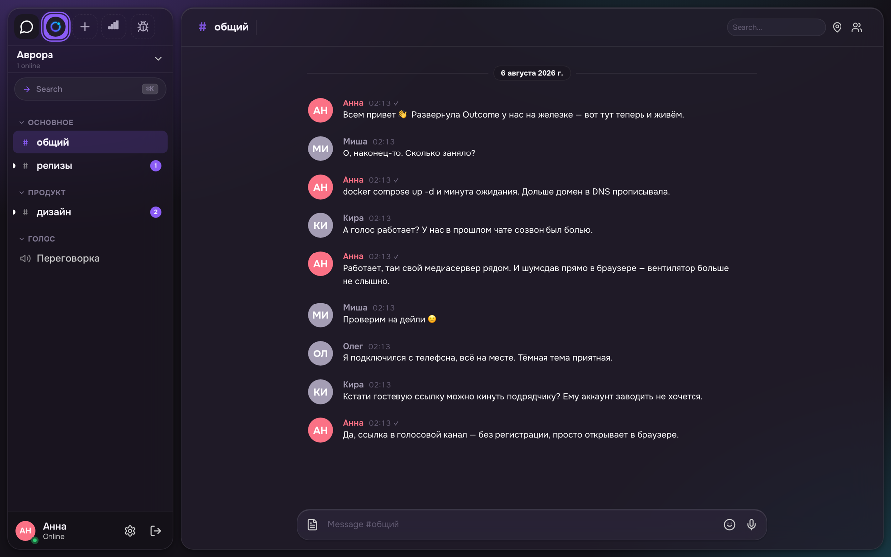
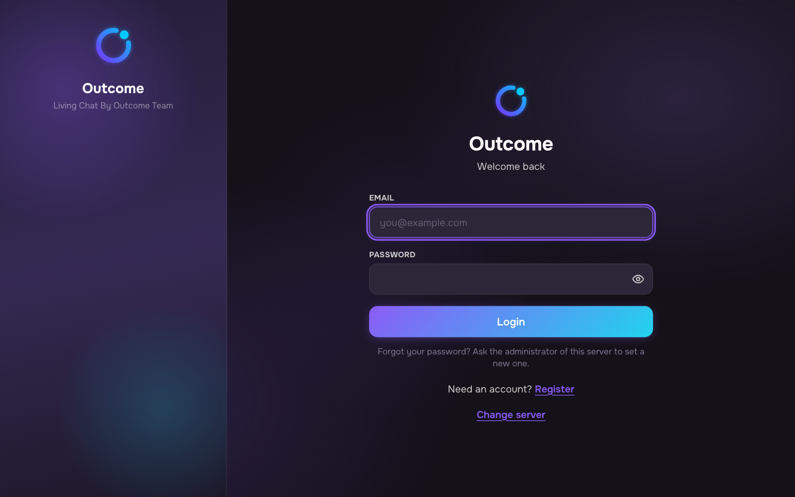
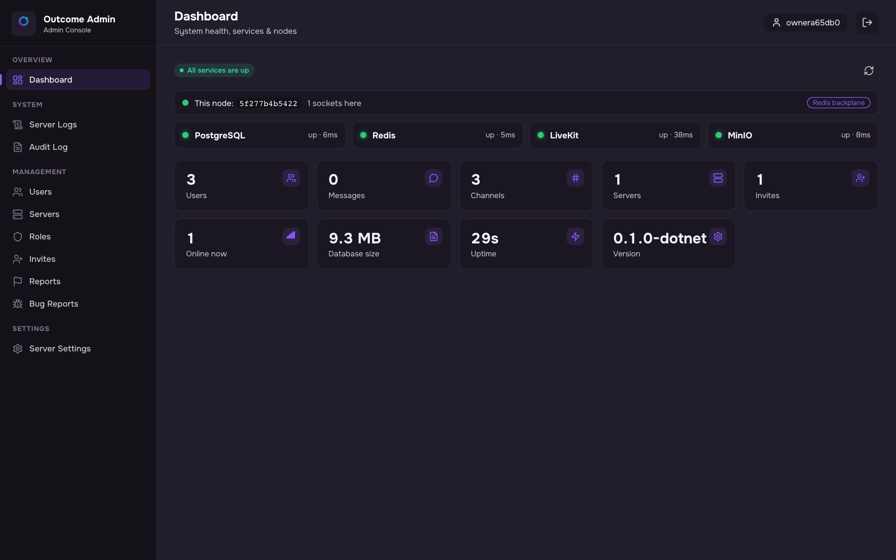
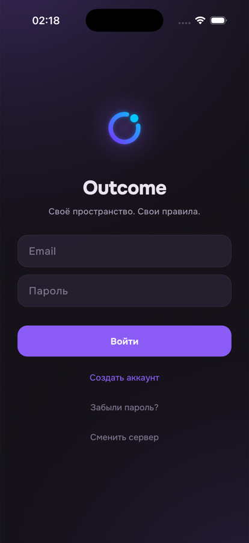
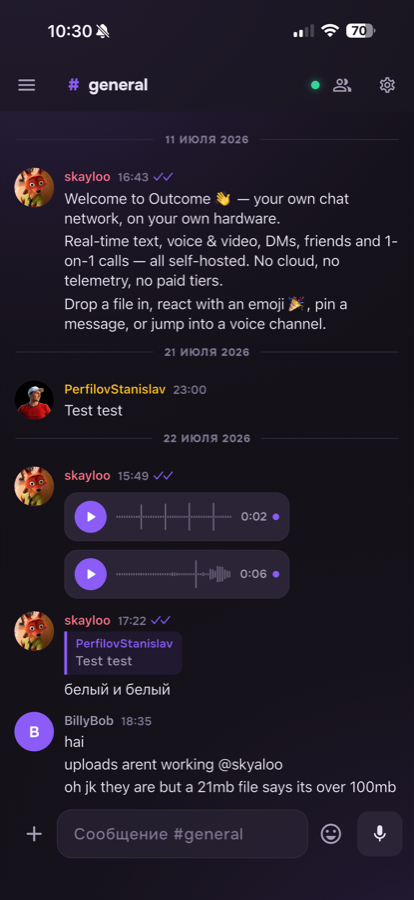
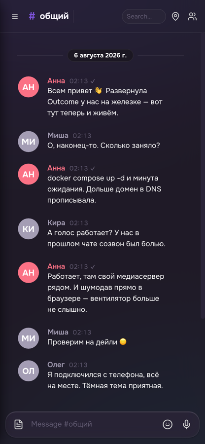
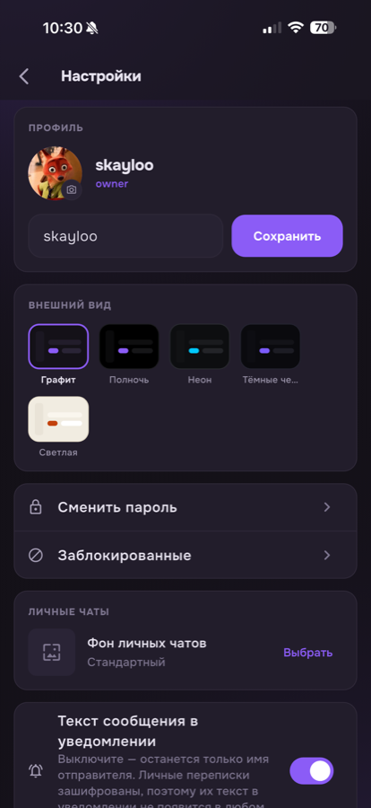

# Outcome

*Живой чат — твой сервер, твои правила.*

**🇬🇧 [Read in English → README.md](README.md)**

> **Ранняя альфа.** Outcome активно разрабатывается и ещё не закалён для продакшена.
> Пока не используйте его для чувствительной переписки. Багрепорты очень приветствуются —
> заводите issue прямо здесь.

**Outcome** — self-hosted чат-платформа в духе Discord, которая целиком работает на
**вашем** железе: без облаков, **без телеметрии**, без платных тарифов. Этот репозиторий —
**комплект развёртывания**: один compose-файл + готовые Docker-образы. Ничего не нужно
собирать из исходников — рабочий инстанс поднимается одной командой `docker compose up -d`.

<p align="center">
  
</p>
<p align="center">
  
  
</p>
<p align="center">
  
  
  
  
</p>

## Почему Outcome

- **Всё в реальном времени** — сообщения по WebSocket: ответы, реакции, закрепы,
  индикаторы набора, отметки прочтения, полнотекстовый поиск, загрузка файлов
  перетаскиванием.
- **Голосовые сообщения** — запись в канал или личку; сервер нормализует в m4a, чтобы
  играло на всех платформах, с перематываемой waveform (веб + мобилка).
- **Голосовые и видео-каналы** — групповой голос, камеры, демонстрация экрана
  (LiveKit SFU). Медиа шифруется в канале связи (DTLS-SRTP) между участником и SFU.
- **Гостевые ссылки в голос** — позвать человека в голосовой канал по ссылке, без
  регистрации.
- **Личные сообщения, друзья, блокировки** — переписка один на один с тем же набором
  возможностей, что и в каналах.
- **Звонки один на один** — «телефонный» экран входящего звонка; звонок офлайн-другу
  ждёт и доставляется, как только он откроет приложение.
- **Настоящее нативное мобильное приложение** для iOS и Android — не обёртка над
  браузером: голосовые каналы, звонки и переписка, push-to-talk — весь функционал в
  кармане. Релизы в сторы на подходе; приложение подключается к любому self-hosted
  инстансу по адресу.
- **Мультиинстансный веб-клиент** — на экране входа есть выбор сервера (как homeserver
  в Matrix): один веб-клиент умеет заходить на любой инстанс Outcome.
- **Роли, инвайты, модерация** — владелец, администраторы и модераторы в каждом сервере,
  над ними — администраторы всего инстанса; регистрация открытая или только по инвайтам.
- **Веб-админка** — пользователи, роли, аудит-лог, живые логи сервера, метрики,
  багрепорты.
- **Защита входа** — двухфакторная аутентификация (TOTP), хэширование паролей Argon2id,
  управление сессиями с кнопкой «отозвать все».
- **Масштабируется в обе стороны** — в простое меньше 2 ГБ RAM; API stateless и
  реплицируется за PgBouncer + Redis, когда нужно больше.

Всё вокруг двух образов Outcome — стандартный опенсорс из публичных реестров:

| Компонент | Роль |
|---|---|
| [`skayloo/outcome-server`](https://hub.docker.com/r/skayloo/outcome-server) | **API Outcome** (.NET) — REST, WebSocket, голосовой сигналинг |
| [`skayloo/outcome-frontend`](https://hub.docker.com/r/skayloo/outcome-frontend) | **Веб-приложение Outcome** (React) за nginx |
| [caddy-docker-proxy](https://github.com/lucaslorentz/caddy-docker-proxy) | Edge TLS, автоматический Let's Encrypt |
| [PostgreSQL 16](https://hub.docker.com/_/postgres) + [PgBouncer](https://hub.docker.com/r/edoburu/pgbouncer) | База + пул соединений |
| [Redis](https://hub.docker.com/_/redis) | Реалтайм-рассылка между репликами API |
| [Garage](https://garagehq.deuxfleurs.fr/) | Хранилище загруженных файлов (S3) |
| [LiveKit](https://hub.docker.com/r/livekit/livekit-server) | Голос/видео SFU (WebRTC) |

## Требования

- Linux-хост (x86_64) с **публичным IP**. Для старта хватит 2 vCPU / 4 ГБ RAM.
- **Docker Engine** 24+ с compose-плагином (`docker compose version` должен работать).
- **Домен** под вашим управлением.
- Открытые (или проброшенные, если за NAT) порты:

  | Порт | Зачем |
  |---|---|
  | 80, 443 tcp (+ 443 udp) | Веб, API, WebSocket, HTTP/3 |
  | 7881 tcp | Голос/видео — TCP-фолбэк |
  | 7882 udp | Голос/видео — основной путь |
  | 5349 tcp | TURN-релей поверх TLS — для сетей, где закрыты оба порта выше (`TURN_TLS_PORT`) |

## DNS

Направьте записи на IP сервера **до** запуска (Caddy должен зарезолвить домен, чтобы
получить сертификаты):

| Запись | Значение |
|---|---|
| `A` `@` (или ваш поддомен) | IP сервера |
| `A` `www` | IP сервера |
| `A` `turn` | IP сервера (сертификат TURN-релея) |

## Быстрый старт

```bash
git clone https://github.com/Skayloo/Outcome.git
cd Outcome
cp .env.example .env
nano .env          # заполните всё — файл объясняет каждое значение и как генерировать секреты
docker compose up -d
```

Первый запуск занимает минуту-две: инициализируется Postgres, накатываются миграции
(безопасно даже с несколькими репликами API — они сериализуются через advisory lock),
Caddy получает сертификаты.

Откройте `https://ваш-домен` — **мастер первого запуска** создаст аккаунт владельца и
выдаст бессрочный инвайт-код для друзей. Регистрация по умолчанию открыта; инвайт-код
сразу добавляет новый аккаунт в ваш сервер. Сделать регистрацию только по инвайтам или
закрыть её можно в админ-консоли (`/admin` → «Настройки сервера»).

**Забытый пароль.** Сервер не отправляет писем, поэтому сброса по почте нет: новый пароль
задаёт администратор — `/admin` → «Пользователи» → меню человека → «Задать пароль».
Человек выходит на всех устройствах; новый пароль передайте ему сами.

Мобильное приложение подключается к вашему инстансу так же — введите свой домен в поле
**«Сменить сервер»** на экране входа.

## Голос и видео

- `LIVEKIT_NODE_IP` в `.env` **обязан** быть публичным IP сервера — он объявляется
  браузерам для медиа-соединения (медиа идёт мимо HTTP-прокси).
- Открытый UDP `7882` = хорошие звонки. Если UDP закрыт, медиа падает на TCP `7881`.
- Голос и видео шифруются в канале связи (DTLS-SRTP) между участником и SFU, который
  расшифровывает поток, чтобы его маршрутизировать. Гостевые ссылки (вход в голосовой
  канал без аккаунта) работают из коробки.

## Порты 80/443 уже заняты другим веб-сервером?

Встроенный Caddy хочет порты 80 и 443 себе. Если их уже держит другой обратный прокси,
выключите Caddy и опубликуйте веб-приложение на локальном порту — создайте рядом с
`docker-compose.yml` файл `docker-compose.override.yml`:

```yaml
services:
  caddy:
    profiles: ["off"]          # не запускается
  frontend:
    ports:
      - "127.0.0.1:8080:80"
```

Затем направьте свой прокси для `ваш-домен` на `http://127.0.0.1:8080`, разрешив
WebSocket и тела запросов до 110 МБ. Например, Caddy:

```
ваш-домен {
    request_body { max_size 110MB }
    reverse_proxy 127.0.0.1:8080
}
```

или nginx (внутри `server { … }` вашего домена, с его сертификатом):

```nginx
client_max_body_size 110m;
location / {
    proxy_pass http://127.0.0.1:8080;
    proxy_http_version 1.1;
    proxy_set_header Upgrade $http_upgrade;
    proxy_set_header Connection "upgrade";
    proxy_set_header Host $host;
    proxy_set_header X-Forwarded-For $proxy_add_x_forwarded_for;
    proxy_set_header X-Forwarded-Proto $scheme;
    proxy_read_timeout 3600s;
}
```

Если сам прокси работает в Docker, порт не публикуйте: подключите веб-приложение к сети
прокси и направьте прокси на `http://outcome-web:80` —

```yaml
services:
  caddy:
    profiles: ["off"]
  frontend:
    networks:
      default: {}
      proxy:
        aliases: ["outcome-web"]
networks:
  proxy:
    external: true
    name: сеть-вашего-прокси      # docker network ls
```

(caddy-docker-proxy больше ничего не нужно: метки, которые он читает, у веб-приложения уже есть.)

Голос по-прежнему идёт напрямую в LiveKit на 7881/7882, мимо прокси. TURN-релей на 5349
включается, только когда встроенный Caddy получил сертификат для `turn.ваш-домен`, так что
с выключенным Caddy он не работает, и звонки идут только через 7881/7882.

## Обновление

```bash
docker compose pull
docker compose up -d
```

Миграции базы накатываются автоматически при старте API. Закрепите `OUTCOME_TAG` в
`.env`, если предпочитаете явные версии вместо `latest`.

### Переезд с MinIO (1.31.78 и раньше)

Файлы раньше лежали в MinIO, который больше не публикует образы; теперь они в
[Garage](https://garagehq.deuxfleurs.fr/). У установки, где работал MinIO, его образ и том
`minio_data` остались — один раз перенесите файлы:

```bash
git pull                     # набор: compose-файл и garage.toml
# допишите в .env GARAGE_RPC_SECRET, GARAGE_ACCESS_KEY и GARAGE_SECRET_KEY (команды — в начале
# .env.example), а строки MINIO_ACCESS_KEY / MINIO_SECRET_KEY пока оставьте
docker compose up -d garage
docker compose --profile migrate run --rm storage-migrate     # копирует все файлы, ничего не удаляет
docker compose up -d                                          # сервер теперь работает с Garage
docker compose --profile migrate rm -sf minio
```

Проверьте, что картинки и файлы открываются, затем удалите старый том
(`docker volume rm <проект>_minio_data`, см. `docker volume ls`) и два ключа `MINIO_*`.

## Бэкапы

Всё состояние лежит в именованных Docker-томах: `pgdata` (база), `garage_data` и `garage_meta`
(загруженные файлы), `caddy_data` (сертификаты).

Консистентный дамп базы без остановки чего-либо:

```bash
docker compose exec postgres pg_dump -U outcome -Fc outcome > outcome-$(date +%F).dump
```

Сохраните и `.env`.

## Масштабирование

API stateless и уже работает в несколько реплик (`SERVER_REPLICAS`); PgBouncer
мультиплексирует соединения к базе, Redis раздаёт реалтайм-события между репликами —
обычно достаточно поднять число реплик на машине пожирнее.

## Благодарности

Outcome стоит на плечах отличного опенсорса. Помимо компонентов стека из таблицы выше,
отдельное спасибо
[**pabloFuente/livekit-server-sdk-dotnet**](https://github.com/pabloFuente/livekit-server-sdk-dotnet) —
.NET SDK для LiveKit, на котором в Outcome работают голосовые токены, управление
комнатами и вебхуки.

## Лицензия

Содержимое этого репозитория (compose-файл, конфигурация, документация) — под MIT, см.
[LICENSE](LICENSE).

Docker-образы `outcome-server` и `outcome-frontend` содержат проприетарное ПО:
**их можно бесплатно скачивать и разворачивать для любых личных и коммерческих целей**,
но декомпилировать, модифицировать и распространять образы или их содержимое нельзя.
Исходный код не публикуется.
